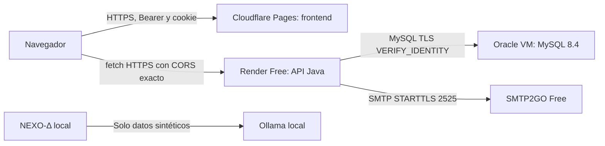

# Publicación en tres proveedores independientes, con presupuesto cero

## Selección al 8/nov/2026

| Componente | Proveedor | Plan previsto | Restricciones reales |
|---|---|---|---|
| HTML, CSS, JavaScript | Cloudflare Pages | Free | 500 builds/mes; Node 24, salida `frontend/dist`. Solo contenido público |
| API Java 21 | Render | Free | 512 MB, 0.1 CPU; reposo tras 15 min sin tráfico; 750 h/mes por espacio; cuotas de tráfico/build. Arranque en frío puede superar el timeout del cliente |
| MySQL 8.4 | Oracle Cloud Infrastructure | VM Ampere A1 Always Free | Autogestionada, no es Autonomous Database. Dentro de 1,500 OCPU-h y 9,000 GB-h/mes, equivalentes a 2 OCPU/12 GB en Free Tier; capacidad regional y validación de cuenta; puede recuperarse por inactividad |
| DNS gratuito | is-a.dev | Subdominio comunitario | Proyecto de desarrollo no comercial, revisión humana, disponibilidad del nombre. No es un dominio comprado ni aprobación garantizada |
| Recuperación por correo | SMTP2GO | Free | 1,000 correos/mes, 200/día y 25/h sin dominio remitente verificado. Requiere remitente validado y puede requerir correo institucional/privado para registrarse |
| NEXO-Δ | Ollama en la computadora del equipo | Local | Sin tarifa de API; requiere hardware, energía y modelo local disponible |

**Objetivo: 0 USD mensuales dentro de cuotas. No es garantía de alta sin tarjeta, sin retenciones o de disponibilidad perpetua.** No activar prueba con conversión automática ni planes de pago. Oracle puede solicitar tarjeta/validación; si el alumno no puede completarla, la publicación MySQL 8.4 queda pendiente. Pedir una cuenta/laboratorio universitario gratuito antes de cambiar de motor. No usar créditos temporales como si fueran gratuidad permanente.

Se descartó Aiven para la ruta cero: su anuncio vigente retira nuevas bases MySQL Free y marca Developer de 5 USD/mes. Se descartó FreeDB para cumplir exactamente la versión: anuncia MySQL 8.0 y bases gratuitas temporales de 30 días. Koyeb tiene cómputo Free y SMTP 587, pero su FAQ advierte retención de tarjeta y posible cobro del plan seleccionado al alta; no se lo presupone una contratación sin costo.

## Comunicación y DNS



No se instala MySQL en Render ni Java en Cloudflare. El navegador jamás habla con MySQL. Oracle se usa solo para la base, no para la API ni frontend. El servicio de correo es auxiliar.

Nombres de ejemplo (no reservados):

| Nombre | Registro | Destino |
|---|---|---|
| `tu-identificador.is-a.dev` | CNAME | `proyecto.pages.dev` |
| `api.tu-identificador.is-a.dev` | CNAME | `servicio.onrender.com` |
| `db.tu-identificador.is-a.dev` | A | IPv4 pública de la VM Oracle |

is-a.dev está en la Public Suffix List. Por ello **dos nombres independientes** como `uno.is-a.dev` y `otro.is-a.dev` son sitios distintos. Se necesita un nombre propio aprobado y **subdominios dentro de él**: `tu-identificador.is-a.dev` y `api.tu-identificador.is-a.dev`. Con ambos HTTPS pertenecen al mismo sitio y a distintos orígenes. La cookie puede seguir `SameSite=Strict`, host-only en la API y `Path=/api/auth`, con `credentials: include` y CORS exacto. No agregar `Domain=.is-a.dev` ni compartir cookies con todos los subdominios.

Mientras solo existan `pages.dev` y `onrender.com`, son sitios distintos. `SameSite=None; Secure` es técnicamente configurable, pero los bloqueos de cookies de terceros pueden impedir refresh. No usarlo como solución garantizada ni pedir al usuario desactivar protecciones del navegador. Esperar el DNS anidado o un subdominio universitario gratuito.

## 1. Empaquetar sin secretos

El repositorio local no tiene `.git` en su raíz. No se creó un repositorio remoto automáticamente. Revisar y subir únicamente fuentes/configuración pública: `frontend/src`, `frontend/public`, manifiestos npm, scripts; fuentes Java, Maven Wrapper, `pom.xml`; `deploy` sin certificados privados; documentación y el agente sin logs privados.

Excluir `.env.local`, archivos de claves/certificados privados, `seguridad/private`, `node_modules`, `target`, copias de seguridad y cualquier volcado de base. `.gitignore` no elimina archivos previamente versionados: inspeccionar el contenido a publicar. El `.dockerignore` excluye todos los `.env*`, dependencias, resultados y documentación del contexto de imagen. No pasar secretos mediante argumentos de build.

## 2. Oracle: base MySQL 8.4

1. En región principal, crear solo una VM que la consola marque Always Free. Usar como máximo 1 OCPU/6 GB RAM para esta actividad, disco de arranque estándar dentro de la cuota compartida de 200 GB. No crear recursos facturables, balanceadores de pago ni activar PAYG para conseguir capacidad.
2. Instalar Docker/Compose desde documentación oficial del sistema elegido. Copiar `deploy/mysql` a una carpeta exclusiva. No copiar `.env.local` del desarrollo.
3. Elegir DNS real de base y generar certificados en una carpeta nueva:

```sh
python3 deploy/mysql/generar-tls.py db.tu-identificador.is-a.dev work/tls-nuevo
```

4. Copiar `server/` generado junto a `compose.yml` y `tls.cnf`. Mantener `ca-private/` fuera del servidor y del repositorio, en resguardo privado. Confirmar UID/GID de `mysql` en la imagen y asignar al archivo `server-key.pem` ese propietario, permiso 600. No hacerlo legible a todo el mundo para resolver errores.
5. Crear `.env` privado (permiso 600) con dos contraseñas aleatorias distintas y `MYSQL_BIND_ADDRESS` igual a la IP privada de la VM. El valor predeterminado 127.0.0.1 es intencionalmente local y no permite conexiones desde Render.
6. En NSG y firewall de la VM, admitir TCP 3306 **solo desde todos los rangos de salida de la región Render que muestra Connect → Outbound**. No usar `0.0.0.0/0`. Admitir SSH únicamente desde la IP administrativa. Docker puede eludir reglas UFW: comprobar NSG y reglas de reenvío/DOCKER-USER, no solo UFW.
7. Arrancar `docker compose --env-file .env up -d`. Esta base persistirá en volumen. No ejecutar `down -v` sobre ella.
8. `MYSQL_USER=identity_app` recibe privilegios sobre la base `identity` para la primera migración; no usar root remotamente. Para la operación posterior, retirar CREATE/ALTER/INDEX/DROP/REFERENCES si ya no se ejecuta Flyway en arranque. No editar V1/V2. Rotar la credencial de migración al acabar.
9. Verificar `SELECT VERSION()`, `SHOW STATUS LIKE 'Ssl_cipher'` desde una conexión remota con `--ssl-mode=VERIFY_IDENTITY`, y fallo con CA/hostname incorrectos. No publicar aún si falla la validación de identidad. El certificado generado dura 90 días; renovarlo antes del vencimiento.

El certificado público de CA se suministra a Render como `DB_CA_CERT_BASE64`; la clave privada de la CA jamás sale del equipo que la custodia. La imagen importa esa CA en una copia del truststore Java que conserva las raíces públicas necesarias para SMTP. `sslMode=REQUIRED` solo cifra; la URL propuesta usa **VERIFY_IDENTITY** para comprobar CA y nombre DNS. No usar `trustServerCertificate=true`, `useSSL=false` ni `allowPublicKeyRetrieval=true` en nube.

## 3. Render Free: API

1. Crear Web Service desde las fuentes revisadas. Runtime Docker, contexto raíz del proyecto, Dockerfile `deploy/Dockerfile.api`, plan **Free**, una región. Confirmar costo cero en la pantalla antes de crear. No activar un upgrade por falta de memoria.
2. Usar los nombres de `deploy/backend.env.example` en el gestor privado del servicio. Reemplazar marcadores. Generar `JWT_SIGNING_KEY` Base64 de al menos 32 bytes aleatorios; no guardarla en frontend, chat o capturas.
3. `DB_URL=jdbc:mysql://db.tu-identificador.is-a.dev:3306/identity?sslMode=VERIFY_IDENTITY&serverTimezone=UTC`; `DB_USERNAME=identity_app`; contraseña privada; `DB_CA_CERT_BASE64` con la CA pública, no la clave.
4. `APP_ALLOWED_ORIGINS=https://tu-identificador.is-a.dev`; `APP_COOKIE_SECURE=true`; `APP_COOKIE_SAME_SITE=Strict`; `APP_RECOVERY_BASE_URL=https://tu-identificador.is-a.dev/reset-password.html`. No añadir barras al origen ni comodines.
5. `SPRING_PROFILES_ACTIVE` vacío o producción: jamás `local` ni `test`. No configurar `PORT` manualmente: el backend acepta el valor que asigna la plataforma. Pool propuesto 5 conexiones; memoria Java limitada a 65% del contenedor.
6. Health check `/api/health`. Esta ruta comprueba MySQL; no imprime credenciales. La primera ejecución sobre esquema vacío aplica Flyway V1/V2, luego Hibernate valida.
7. Para el primer administrador, usar bootstrap explícito con email y contraseña aleatoria en secretos, reiniciar una vez, comprobar acceso y retirar `APP_BOOTSTRAP_ENABLED`, `APP_BOOTSTRAP_EMAIL`, `APP_BOOTSTRAP_PASSWORD`. No capturar valores. La autodesactivación no está permitida.
8. Tras migrar y reducir permisos DDL, establecer `SPRING_FLYWAY_ENABLED=false`. Hibernate seguirá validando esquema. Para una futura V3, usar ventana y credencial de migración controlada; volver a deshabilitar después.
9. Registrar el dominio `api.tu-identificador.is-a.dev` en Render y su CNAME en el registro gratuito. Esperar certificado HTTPS válido. Abrir `/api/health` antes de la exposición para completar arranque en frío; no crear tráfico artificial permanente para evitar reposo.

El build de imagen usa `-DskipTests` para empaquetar; **eso no es una prueba**. Las pruebas ejecutadas aparte están en evidencia. `-Papi-only` excluye `static/**` del JAR, aun cuando existan recursos integrados de desarrollo en el árbol de fuentes.

## 4. Correo gratuito real

Render Free bloquea TCP 25, 465 y 587. SMTP2GO publica STARTTLS en 2525, que no está en esa lista. Es una compatibilidad documental que **debe probarse desde el servicio real**, no se ha demostrado desde Render en esta sesión.

Configurar `SMTP_HOST=mail.smtp2go.com`, `SMTP_PORT=2525`, `SMTP_AUTH=true`, `SMTP_STARTTLS=true`, usuario/clave SMTP propios y `SMTP_FROM` verificado. SMTP2GO advierte que el alta no admite correos públicos como Gmail/Yahoo: intentar con correo institucional autorizado, sin inventar datos. Si no se puede validar una cuenta gratuita, SMTP real queda pendiente; Mailpit prueba la recuperación local pero no reemplaza la entrega pública.

No desactivar STARTTLS ni cambiar a modo development en nube. Las cuotas o retrasos del proveedor pueden invalidar un enlace de 15 minutos antes de su entrega. Probar recuperación con un buzón de prueba controlado; no enviar mensajes a terceros.

## 5. Cloudflare Pages: frontend

1. Proyecto Pages Free, raíz `frontend`, Node 24, comando `npm ci && npm run build`, salida `dist`.
2. Variable pública de build: `APP_API_BASE_PATH=https://api.tu-identificador.is-a.dev/api`. No contiene ningún secreto. Si cambia, reconstruir frontend.
3. Publicar `dist`, que contiene HTML, JS, CSS y `_headers` (CSP con connect-src limitado al origen API). El build normal no modifica recursos Java.
4. Solicitar el subdominio en is-a.dev para el proyecto académico no comercial. Los ejemplos están en `deploy/dns`; sustituir dueño GitHub/nombres/destinos, revisar la política y esperar aprobación. Se requiere poseer el dominio padre para los anidados.
5. Agregar hostname en Pages antes de esperar que funcione el CNAME. Por la Public Suffix List, la guía is-a.dev señala que puede ser necesaria la API oficial de Cloudflare para asociar el nombre. Usar esa API desde el propio equipo o panel oficial, nunca pegar tokens en un sitio de terceros.
6. Usar el hostname aprobado como origen público. No añadir indiscriminadamente dominios de previews al CORS de producción.

## 6. Evidencia pendiente de nube

Capturar paneles sin secretos que demuestren tres proveedores, URLs HTTPS, DNS/CNAME, versión MySQL 8.4, Flyway 1 y 2 con éxito, conexión TLS, cookies, OPTIONS CORS y rechazo de origen ajeno, login → recarga/refresh → logout, recuperación SMTP a buzón sintético. Registrar fecha, comando, estado esperado/obtenido y limitaciones. **Esta lista no afirma que se haya realizado.**

## Fuentes oficiales consultadas

- [Cloudflare Pages Free: límites](https://developers.cloudflare.com/pages/platform/limits/).
- [Render Free: reposo, cuotas y bloqueo SMTP](https://render.com/docs/free).
- [Render: rangos de salida](https://render.com/docs/outbound-ip-addresses).
- [Oracle Always Free: límites actuales y recuperación por inactividad](https://docs.oracle.com/en-us/iaas/Content/FreeTier/freetier_topic-Always_Free_Resources.htm).
- [is-a.dev: requisitos](https://docs.is-a.dev/quickstart/), [subdominios anidados](https://docs.is-a.dev/faq/) y [Cloudflare Pages](https://docs.is-a.dev/guides/cloudflare-pages/).
- [SMTP2GO Free](https://support.smtp2go.com/hc/en-gb/articles/223087947-Free-Plan) y [puertos/alta](https://www.smtp2go.com/setup/).
- [Retiro de Aiven MySQL Free](https://aiven.io/free-mysql-database-retired).
- [Koyeb: condiciones de alta y planes](https://www.koyeb.com/docs/faqs/pricing).
- [Connector/J: sslMode y truststores](https://dev.mysql.com/doc/connector-j/en/connector-j-connp-props-security.html).
- [Cookies y sitio](https://developer.mozilla.org/en-US/docs/Web/HTTP/Guides/Cookies), [credentials](https://developer.mozilla.org/en-US/docs/Web/API/Request/credentials).
