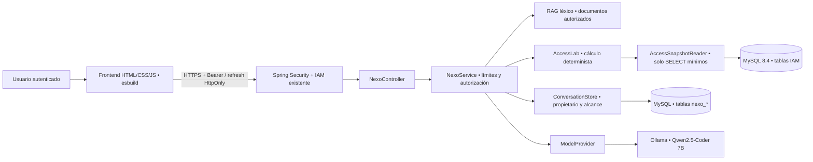

# Auditoría y arquitectura implementada

## Estado inicial comprobado

Se inventariaron fuentes, recursos, migraciones, pruebas, frontend, scripts, configuración de despliegue, agente Python y documentación previa. Se conservaron copias de las fuentes iniciales y hashes en `evidencia/antes.json`; los archivos de secretos se excluyeron del inventario público. No existe `.git` en la raíz, por lo que no se generó commit ni se publicaron cambios.

Java configurado: 21; Spring Boot: 4.1.1; Maven Wrapper: 3.9.11; MySQL: 8.4; esbuild: 0.28.2; Node local: 24.16.0; Python local: 3.14.7. La JVM predeterminada de la Mac es 26: las verificaciones y la construcción del lanzador usan el contenedor Java 21. Docker 29.8.0 está disponible ahora. El puerto 8090 inicialmente no respondía. Se detectaron servicios ajenos ya activos y se conservaron.

Línea base de esta ejecución: 41 pruebas Java, 17 frontend y 12 Python. La cifra histórica de 65 del 4 de noviembre es un antecedente, no el resultado de este trabajo. El agente anterior ya ejecutaba IA real para explicar tres fixtures; no tenía conversaciones integradas, historial IAM ni RAG.

## Problema y solución

ExamenErik resuelve registro, autenticación, recuperación y administración de identidad. Un administrador puede asignar un rol sin comprender todas las consecuencias. NEXO ayuda a explorar esas consecuencias **antes** de decidir, sin realizar la modificación. La conversación ofrece ayuda general y contextual; el laboratorio aporta una diferencia verificable frente a un chatbot genérico.

La API no ejecuta Python para atender peticiones. El núcleo del simulador se trasladó a Java, conservando la metodología y los fixtures del motor Python. Pruebas de paridad comprueban los puntajes 60/60/70, alternativas 0/60/0 y el caso de vencimiento 55. La demo Python continúa funcionando de forma independiente.

## Flujo de un turno

1. Spring valida JWT, estado, versión de sesión y autoridades consultadas en MySQL.
2. Se exige `profile:read`, propietario del chat y el mismo conjunto de permisos/roles que al crearlo.
3. Se validan tamaños, tipo de archivo y patrones sensibles; se aplican cuotas.
4. Java procesa adjuntos y consultas explícitas de arquitectura sin enviarlos al planificador. Las demás consultas automáticas usan un plan JSON de una sola herramienta, validado contra una lista cerrada.
5. La herramienta consulta únicamente documentación permitida, interpreta texto aportado o calcula una hipótesis autorizada. No hay herramientas que ejecuten cambios.
6. La búsqueda documental devuelve extractos de hasta tres fuentes con ACL y citas asignadas por el servidor. Para los turnos generativos se usan hasta 12 mensajes recientes con un máximo de 9000 caracteres, más hasta tres fragmentos históricos relevantes de 500 caracteres del mismo chat.
7. Los turnos generativos reciben tokens reales. Los eventos NDJSON incluyen `status`, `context`, `delta`, `done`, `truncated` y `error`. La interfaz identifica los extractos y plantillas locales.
8. Durante la inferencia, un observador comprueba periódicamente la reserva, el estado de cuenta, la versión y las autoridades. El guardado revalida sesión y reserva. La cancelación marca el turno en MySQL y el proceso que ejecuta la inferencia interrumpe la solicitud HTTP a Ollama.
9. Solo un turno completo se guarda. Los turnos parciales o fallidos no se convierten en respuestas ficticias.

El validador de salida pide aclarar límites explícitos incompatibles de palabras, líneas, frases o párrafos en español e inglés. Otras contradicciones se delegan al modelo. En simulación, el modelo elige el enfoque y Java renderiza las cifras y las unidades desde el resultado calculado.

## Herramientas y frontera de confianza

| Herramienta | Entrada y ejecución | Permiso |
|---|---|---|
| general | Conversación sin acceso a sistemas | profile:read |
| search_docs | Búsqueda léxica en cinco documentos compilados | ACL por documento |
| explain_error | Interpretación del texto/código recibido; no lo ejecuta | profile:read |
| interpret_tests | Interpretación de resultados aportados; no inicia pruebas | profile:read |
| report | Ollama elige título y prioridad; Java conserva y muestra los fragmentos aportados | profile:read |
| read_attachment | Extracción local de código de inventario o primer extracto de texto | profile:read |
| simulate_self | Hipótesis fija y explícita de cuenta propia → ADMIN | profile:read |
| simulation | Escenario estructurado elegido por usuario | Propio o users:read + users:write para otras cuentas/catálogo |

La selección de una herramienta por el modelo no concede permisos. El modelo no puede escoger URLs, rutas de archivos, SQL ni comandos. La hipótesis automática es deliberadamente fija; cuando no corresponde con la pregunta debe aclararse. Cambios complejos se configuran en el laboratorio. La arquitectura permite agregar herramientas mediante validación, ACL, ejecución y auditoría explícitas; no carga plugins de mensajes.

## Persistencia y aislamiento

V1 y V2 permanecen intactas. V3 crea `nexo_conversation`, `nexo_message` y `nexo_audit`. El propietario se enlaza a `app_user`; los mensajes se eliminan en cascada al borrar el chat. La retención es fija desde la creación, 7 días por defecto, configurable entre 1 y 30; los chats vencidos dejan de ser accesibles inmediatamente y una tarea horaria los purga. Auditoría: 30 días.

Máximo 30 chats vigentes por usuario, 40 turnos por chat, una inferencia simultánea por usuario y dos por instancia. Cuota diaria de turnos iniciados en la base, cuota por minuto compartida en MySQL desde V5. La reserva V4 se renueva durante inferencia y caduca en 20 segundos si el proceso cae. La cuota diaria se evalúa bajo esa reserva. La capacidad de inferencia sigue limitada por instancia.

El alcance del chat es una huella HMAC de autoridades. Al cambiar roles/permisos, los chats del alcance anterior se ocultan para evitar reutilizar contexto más privilegiado. Volver exactamente a las autoridades previas puede recuperar el chat si no venció. El texto de los adjuntos no se comparte con el modelo. Los mensajes históricos con adjuntos se filtran al reconstruir el contexto. Los extractos guardados están disponibles en el historial de su propietario.

Auditoría almacena evento, fecha y huella HMAC del actor, sin pregunta, respuesta, correo, token ni contraseña. Las conversaciones sí contienen texto privado en MySQL: requieren protección de disco/backups por el operador. No hay cifrado aplicativo por usuario. Cambiar la clave JWT invalida sesiones y cambia las huellas de alcance.

## Seguridad y límites

Se conservan cookie HttpOnly, Secure fuera de local/test, SameSite configurable, refresh/logout con Origin exacto y JSON, Bearer en memoria y CORS explícito. Los endpoints NEXO no autentican por cookie. Se mantiene el límite global de cuerpos de 16 KiB y CSP. La interfaz usa nodos de texto incluso para código y resultados del modelo; no interpreta HTML generado.

Las instrucciones del sistema reducen prompt injection, pero no son una garantía de comportamiento del LLM. La barrera importante son ACL, herramientas cerradas, ausencia de credenciales en el contexto y falta de operaciones de escritura. El detector de secretos es heurístico: rechaza patrones comunes y puede producir falsos positivos/negativos. Nunca debe considerarse una solución completa de prevención de fugas.

## Metodología contrafactual

`min(100, ganancias de privilegio + min(20, 5 × tokens conocidos invalidados) + penalización de 40 si no quedan escritores en un snapshot completo)`.

Pesos: profile:read 2, users:read 15, users:write 35. Bajo <25, medio 25–59, alto ≥60. La ganancia se acumula por usuario afectado, aunque su cuenta esté inactiva; así se representa exposición latente. Los estados inactivos no aportan sesiones ni escritores activos. Un permiso desconocido detiene el cálculo hasta definir su peso.

Asignar roles revoca incluso cuando el conjunto no cambia. Los tokens vencidos antes del horizonte no suman disrupción. Las hipótesis sobre el catálogo compartido cambian las autoridades, pero no incrementan la versión ni revocan tokens. No existe endpoint real para editar ese catálogo.

Para lectura real se extraen roles, estado y conteo de refresh vigentes; no emails, contraseñas, hashes, UUID de otros usuarios ni valores de tokens. Los JWT de acceso no se almacenan: su cantidad es desconocida y el puntaje es parcial. Un usuario normal solo observa su cuenta y no puede concluir que desapareció el último administrador. Un administrador autorizado puede usar un snapshot completo de hasta cien cuentas; con más se rechaza el análisis global. El horizonte mantiene los roles observados constantes; no predice cambios concurrentes ni futuras recuperaciones de cuentas.

Las alternativas enumeran combinaciones de hasta ocho roles existentes y minimizan peso de permisos sobrantes y número de roles. No inventan un rol lector inexistente. El rollback es una propuesta de restauración del catálogo/roles y nueva autenticación: jamás resucita tokens ni reduce `session_version`. La auditoría NEXO puede escribirse, pero las tablas IAM no se modifican durante una simulación.
