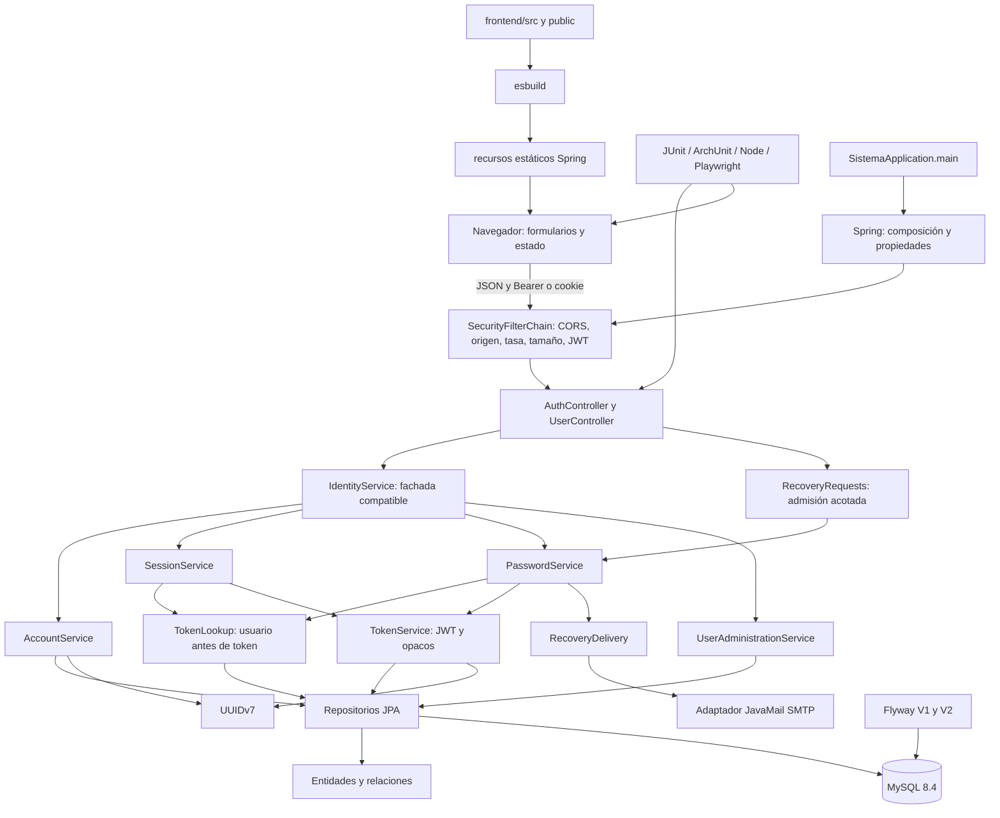

# Orquestador principal — ExamenErik

Referencia central de arquitectura y coordinación documental. Actualizado el **4 de noviembre de 2026**, zona America/Mexico_City.

**Markdown no ejecuta componentes.** El arranque es [`SistemaApplication.main`](sistema-m01-m02/src/main/java/com/sistemam01m02/SistemaApplication.java). Spring compone beans; los servicios de aplicación coordinan casos de uso. Un agente/desarrollador debe abrir este índice expresamente y seguir sus referencias: no existe un mecanismo que cargue o ejecute automáticamente estos documentos.

## 1. Identificación y estado

**Solución:** ExamenErik. **Objetivo:** identidad segura y verificable: registro, login, perfil, sesiones, recuperación de acceso y administración RBAC.

Monolito modular Java 21 / Spring Boot 4.1.1 / MySQL 8.4. Frontend HTML/CSS/JavaScript nativo modular, compilado con esbuild y servido por Spring en el mismo origen. Persistencia JPA, migraciones Flyway, JWT HS256, Argon2id y correo SMTP. Docker Compose para desarrollo; Maven Wrapper 3.9.11 y Node 24+ para construcción/pruebas. No se añadieron pantallas o dominios ajenos a identidad.

**Estado real y resultados:** [informe final A–L](documentacion/auditoria/INFORME_FINAL.md), [matriz de integración](documentacion/auditoria/MATRIZ_INTEGRACION.md), [evidencia ejecutada](documentacion/auditoria/evidencia-final.json). Una fuente o dependencia declarada no acredita funcionamiento. Los documentos anteriores de `docs/auditoria-integral` y `docs/integracion` se conservan como antecedentes; la evidencia de esta intervención tiene fecha y hashes propios.

### Índice de los tres documentos principales

- **Este orquestador:** visión global, contratos entre módulos, ejecución, riesgos y trazabilidad.
- [documentadorFrontend.md](documentacion/frontend/documentadorFrontend.md): fuentes, vistas, formularios, estado, red, permisos, build y pruebas.
- [documentadorBackend.md](documentacion/backend/documentadorBackend.md): entidades, servicios, seguridad, SQL, transacciones y operación.
- [OpenAPI 0.2.0](docs/integracion/openapi.json): contrato HTTP vigente. Registro ahora responde 202 genérico; no devuelve un ID público.
- [Auditoría inicial](documentacion/auditoria/LINEA_BASE.md), [cambios](documentacion/auditoria/CAMBIOS.md), [política de seguridad](sistema-m01-m02/SECURITY.md), [migraciones](sistema-m01-m02/src/main/resources/db/migration/README.md).

## 2. Estructura y mapa de componentes

```text
ExamenErik/
├── orquestador.md / README.md
├── documentacion/
│   ├── frontend/documentadorFrontend.md
│   ├── backend/documentadorBackend.md
│   └── auditoria/                       Línea base, matriz, informe y evidencia
├── frontend/
│   ├── public/index.html                Plantilla única
│   ├── src/{app,api-client,ui}.js        Presentación y comunicación HTTP
│   ├── src/styles.css
│   ├── tests/{unit,e2e}/
│   └── scripts/build.mjs                Salidas hacia recursos Spring
├── sistema-m01-m02/
│   ├── pom.xml / mvnw / compose.yml / Dockerfile
│   ├── src/main/java/com/sistemam01m02/
│   │   ├── SistemaApplication.java
│   │   ├── config/                      Composición, propiedades, bootstrap, salud
│   │   ├── identity/{api,dto,service,security,entity,repository}/
│   │   └── shared/{error,persistence}/
│   ├── src/main/resources/{application.yml,db/migration,static}/
│   ├── src/test/                        Reglas, arquitectura e integración
│   └── scripts/                         Entorno, verificación y smoke aislado
├── scripts/verificar.sh                 Secuencia completa de verificación
└── docs/                                Antecedentes y OpenAPI vigente
```

Los recursos `static` son salidas generadas, no un módulo duplicado. Se mantienen URLs existentes y se reutiliza código funcional. No editar esos archivos a mano.



El orden de una petición es navegador → frontera HTTP/filtros de seguridad → controlador → servicio → repositorio → MySQL → DTO/respuesta. El diagrama también representa dependencias, no solo secuencia temporal. No todas las peticiones necesitan todos los componentes (salud y autenticación son casos distintos).

## 3. Jerarquía, responsabilidades y dependencias

| Componente | Controla | No debe controlar |
|---|---|---|
| Frontend `app.js` / `ui.js` | Vistas, campos, foco, carga, permisos visibles y navegación | Reglas definitivas de cuenta o permisos |
| `api-client.js` | JSON, timeout, contrato, Bearer y renovación | Persistencia o privilegios |
| `SecurityConfig` / filtros | Autenticación, origen, CORS, límites y cabeceras | Casos de uso de negocio |
| Controladores | Traducción HTTP, DTO, cookie, códigos y permisos del endpoint | SQL o estado JPA directo |
| `IdentityService` | Fachada compatible entre API/bootstrap y servicios | Unificar toda la lógica en una clase universal |
| `AccountService` | Registro, normalización y perfil | SMTP o navegación |
| `SessionService` | Login, refresh, logout y bloqueos de acceso | Formularios |
| `PasswordService` | Cambio y recuperación transaccional | Responder o demorar HTTP |
| `UserAdministrationService` | Listado paginado, roles y desactivación | Crear roles arbitrarios desde el cliente |
| `RecoveryRequests` | Admisión con dos trabajadores/cola 64 antes de buscar cuenta | Entrega durable o estado del navegador |
| Entidades | Invariantes y transiciones | HTTP, correo o controladores |
| Repositorios | Consultas, grafos y bloqueos | Mensajes de presentación |
| Puerto SMTP | Entregar enlace con tiempos acotados | Determinar la respuesta pública por existencia de cuenta |

Inyección por constructor. Sin dependencia servicio → controlador. Dominio no depende de Spring web ni de servicios. Repositorios no dependen de presentación. `TokenService` no vuelve a llamar a la fachada. Configuración es composición y puede referenciar implementaciones. ArchUnit verifica cinco reglas de capas y ausencia de ciclos entre paquetes de identidad; arranque Spring verifica el grafo real de beans. No se afirma ausencia universal de ciclos en dependencias de terceros.

## 4. Contratos de integración

| Emisor → receptor | Protocolo / interfaz | Entrada → salida | Validación, seguridad y fallos | Límite / verificación |
|---|---|---|---|---|
| Navegador → API | HTTP JSON `/api/**` | DTO → Access/UserView/Message o vacío | HTML + Bean Validation; Bearer o cookie según ruta; Problem seguro | 20 s cliente, POST/PUT ≤16 KiB; Node + E2E + integración |
| API → fachada/servicios | Llamada Java por constructor | Contracts → vistas/Session interna | Métodos autorizados; excepción de negocio traducida | Transacción por caso de uso; ArchUnit + HTTP |
| Sesión → TokenService | `access(user)`, `opaque(user,kind)` | Usuario/tipo → secreto o JWT | Clave ≥256 bits; hash opaco persistido, TTL | Login/rotación/expiración comprobados |
| Sesión/contraseña → TokenLookup | `lockedToken(raw,kind)` | Token → entidad bloqueada | Patrón y hash; usuario antes de token; 401 genérico | Pruebas concurrentes refresh y reset |
| Servicio → repositorio | JPA/SQL | UUID/email/hash → entidades/actualización | FK, unicidad, bloqueos, rollback | JDBC/pool configurado; MySQL Testcontainers |
| RecoveryRequests → PasswordService | Cola Java acotada en memoria | Forgot → tarea transaccional | Admisión previa a identidad; saturación 503 uniforme | 2 trabajadores, 64 en cola; test de saturación |
| PasswordService → RecoveryDelivery | `send(recipient,url)` / SMTP | Destinatario + enlace → entrega local o excepción | STARTTLS fuera de local/test; sin tokens en logs | Conexión/lectura/escritura 5 s; GreenMail y Mailpit |
| Flyway → MySQL | SQL versionado | V1/V2 → esquema validado JPA | clean-disabled, baseline automático desactivado | Migración en base nueva y validación de FK |
| Herramientas frontend → Spring | Compilación/copia | Fuente única → cuatro archivos estáticos | API solo mismo origen, sin secretos cliente | esbuild + hash de recursos/JAR |
| Tests → infraestructura | Docker API local | Recursos temporales propios → evidencia | Sin DB/SMTP reales; eliminación solo de recursos propios | Smoke y E2E aislados |

### Operaciones HTTP vigentes

Todas las entradas JSON usan contratos [OpenAPI](docs/integracion/openapi.json). Los tiempos del cliente no provocan reintento automático de mutaciones. Todos los errores no indicados específicamente pueden incluir 400/413/415/429/500 según frontera.

| Método/ruta (prefijo `/api`) | Entrada → salida | Autenticación / permiso | Errores relevantes y prueba |
|---|---|---|---|
| GET `/health` | — → UP/DOWN | Público | 503 si DB falla; `bootMigrationsAndHealth` |
| POST `/auth/register` | Register → 202 Message genérico | Público | 400 dominio/campos; alta y duplicado indistinguibles, incluida carrera; `registrationResponsesHideExistingAccountsIncludingConcurrentRequests` |
| POST `/auth/login` | Login → 200 Access + cookie | Público | 401 uniforme; `failedLoginCommitsAndLockExpires` |
| POST `/auth/refresh` | `{}` + cookie → 200 Access + cookie nueva | Origin permitido + JSON | 401 inválido/expirado/reusado, 403 origen; tests de rotación/concurrencia |
| POST `/auth/logout` | `{}` + cookie → 204 | Origin permitido + JSON | Idempotente si ausente/desconocido/expirado; revoca si identifica sesión vigente; test de logout expirado |
| POST `/auth/forgot-password` | Forgot → 202 Message | Público | 503 cola llena sin buscar identidad; SMTP no afecta tiempo/respuesta; test cola y SMTP fallido |
| POST `/auth/reset-password` | Reset → 204 | RESET vigente, uso único | 401 inválido/expirado/usado; SMTP E2E y reset concurrente |
| POST `/auth/change-password` | ChangePassword → 204 | Bearer, profile:read | 401 contraseña actual incorrecta sin borrar sesión en cliente; revoca al éxito |
| GET `/users/me` | — → UserView | Bearer, profile:read | 401/403; perfil/RBAC/XSS representado como texto |
| GET `/admin/users` | page≥0, size 1–100 → lista | Bearer, users:read | 400/401/403; ≤3 consultas para diez usuarios y E2E paginado |
| PUT `/admin/users/{id}/roles` | Roles → UserView | Bearer, users:write | 400 rol inválido, 404 usuario, 401/403; revoca destino |
| DELETE `/admin/users/{id}` | — → 204 | Bearer, users:write | 404 usuario, 409 autodesactivación; desactivación lógica y revocación |

UserView solo contiene id/email/displayName/status/roles/permisos. Access contiene accessToken/tokenType/expiresIn. Refresh nunca se devuelve como JSON. El registro ya no devuelve un ID sin autenticación. El cliente obtiene su ID mediante login + perfil.

## 5. Casos de uso: secuencia y recuperación

| Caso / disparador | Precondiciones y secuencia real | Transacción y resultado | Fallo / recuperación / aceptación |
|---|---|---|---|
| Arranque | Entorno válido → Spring → DataSource → Flyway → Hibernate → composición → bootstrap opcional | Esquema nuevo, salud MySQL y login ADMIN si se solicitó | Config inválida o base sin historial no vacía: impedir arranque; corregir entorno sin desactivar controles; smoke |
| Registro / enviar formulario | DTO/dominio válido → hash Argon2 → buscar duplicado → crear USER si no existe | AccountService; 202 genérico para nuevo/existente, sin ID ficticio | Validación 400; carrera de email vuelve a genérico; intentar login/recuperar; pruebas de unicidad concurrente |
| Acceso | DTO → lock usuario → comprobar hash/estado → desbloquear solo si vencido → contar fallo o emitir sesión | SessionService; fallos de login se confirman con noRollbackFor(LoginRejected) | 401 igual para estados/credenciales; esperar bloqueo o recuperar; tests concurrencia/expiración |
| Petición protegida | Verificar firma/emisor/tiempo → DB estado/versión → autoridades activas → @PreAuthorize → controlador | Lectura o transacción del servicio correspondiente | 401 Bearer renueva una vez; 403 no renueva; test Node y seguridad HTTP |
| Renovación | Origin/JSON → hash → lock usuario → lock token → vencimiento/consumo → consumir y emitir nuevo | SessionService atómico; reutilización vigente revoca todo aun respondiendo 401 | Expirado nunca invalida nuevas sesiones; navegador serializa con promesa/Web Locks; test 2 pestañas |
| Logout | Origin/JSON → identificar refresh → lock usuario/token → verificar vigencia → revocar | SessionService; cookie borrada y estado local vacío | Ausente/expirado: 204 sin revocar accesos nuevos; E2E y test negativo |
| Recuperación / correo | Validar DTO → admitir en cola → responder 202 → trabajador busca cuenta → revoca RESET anterior → nuevo hash → SMTP | PasswordService en trabajador; rollback si SMTP falla | Cola llena 503; entrega fallida log seguro, pedir otro enlace; no es cola durable; test saturación + SMTP real/fallido |
| Reset / enlace recibido | Capturar fragmento y quitarlo → JSON → lock usuario/token → validar vigencia/estado → hash nuevo → versión++ y revocar | PasswordService; 204 | Usado/vencido 401, pedir otro enlace; una sola victoria concurrente y E2E completo |
| Cambio de contraseña | Bearer/profile:read → lock usuario → verificar actual → hash nuevo y revocar | PasswordService; 204 y volver a login | Credencial incorrecta 401 de negocio, cliente mantiene sesión; E2E |
| Administrar | users:read para página; users:write para roles/estado → validar usuario/roles → lock → cambio/revocación | UserAdministrationService; listado/DTO/204 | Permisos 403, rol 400, recurso 404, autodesactivación 409; E2E y pruebas negativas |

## 6. Datos, consistencia y migraciones

AppUser ↔ Role ↔ Permission por tablas M:N; AccountToken N:1 AppUser. Correo único, FK y claves compuestas. UUIDv7 en usuarios/tokens; orden garantizado por instancia incluso con reloj fijo/en retroceso, sin espera activa al agotar secuencia. UTC y DATETIME(6). Relaciones LAZY se materializan dentro de transacciones; DTO no expone entidades/hash.

V1 crea identidad y V2 agrega sesiones/tokens/semillas. Se conservan sus contenidos; nuevas modificaciones requieren V3. `ddl-auto=validate`, `baseline-on-migrate=false`, `clean-disabled=true`. No se ejecuta adopción sobre datos existentes. Para ello, comparar primero una copia aislada con tipos/índices/FK y planear baseline explícito: activar baseline a ciegas no es una corrección.

## 7. Seguridad y manejo de errores

- Argon2id, JWT HS256 con emisor/tiempo y versión de sesión; roles actuales desde DB, nunca confiados desde el cliente.
- Cookie HttpOnly/SameSite=Strict/Path=/api/auth; Secure obligatorio fuera de local/test. CORS exacto y JSON/Origin obligatorio en refresh/logout. CSRF desactivado solo con este diseño Bearer + defensas explícitas de cookie.
- Tasa por fingerprint HMAC del socket, memoria acotada, por nodo; sin confiar en cabeceras reenviadas de clientes. JSON ≤16 KiB aun chunked, no-store y CSP del mismo origen.
- Configuración inválida impide arranque. Validación 400, autenticación 401, permiso/origen 403, recurso 404, conflicto 409, fallo inesperado 500. También 405/413/415/429/503. GlobalExceptionHandler/ApiErrors traducen sin stacktrace/SQL/secretos; CORS del framework puede emitir 403 sin JSON.
- Registro uniforme y recuperación admitida antes de consultar identidad. No se promete indistinguibilidad temporal matemática sobre redes; se eliminó la confirmación directa y la dependencia del tiempo SMTP.
- SMTP/SQL fallidos se registran de forma segura; Hibernate no imprime valores de errores JDBC. Salud no revela detalles ni garantiza SMTP. No hay auditoría persistente ni trazas distribuidas implementadas.

## 8. Entornos, construcción y ejecución

Requisitos: Docker/Compose, Node 24+/npm y OpenSSL; Python 3 para smoke. Java 21/Maven pueden ejecutarse dentro de Docker. Para E2E: Chromium instalado por Playwright o Chrome instalado mediante `PW_CHANNEL=chrome`.

Desde raíz:

```sh
npm --prefix frontend ci
npm --prefix frontend run check
sistema-m01-m02/scripts/verify-java21.sh
python3 sistema-m01-m02/scripts/smoke-isolated.py
cd frontend
npx playwright install chromium
npm run test:e2e
```

O, tras instalar el navegador, `./scripts/verificar.sh` desde raíz; con Chrome existente, `PW_CHANNEL=chrome ./scripts/verificar.sh`.

Para desarrollo, desde `sistema-m01-m02`:

```sh
./scripts/init-local.sh
docker compose --env-file .env.local up --build -d
```

Interfaz/API <http://localhost:8090>, salud <http://localhost:8090/api/health>, Mailpit <http://localhost:8026>. `.env.local` es generado con permiso 600 y secretos aleatorios; nunca se sobrescribe. Detener conservando datos: `docker compose --env-file .env.local stop`. No eliminar volúmenes para resolver errores de arranque.

Primer ADMIN: **solo antes de registrar usuarios**, configurar explícitamente APP_BOOTSTRAP_ENABLED=true, APP_BOOTSTRAP_EMAIL permitido y APP_BOOTSTRAP_PASSWORD propia en `.env.local`; iniciar y confirmar login. Luego desactivar bootstrap, quitar su contraseña y recrear backend. No existe usuario/contraseña administrativa predeterminada.

Producción: exportar variables de `.env.example` con credenciales reales, esquema revisado, orígenes/recuperación HTTPS, cookie Secure, SMTP STARTTLS. Las plantillas no se cargan automáticamente. Frontend no contiene secretos. No se publica ni despliega a producción como parte de esta tarea.

## 9. Criterios de integración y trazabilidad

Cada fila de la [matriz](documentacion/auditoria/MATRIZ_INTEGRACION.md) identifica componente, archivos, prueba, resultado y pendiente. Para marcar «verificado» debe existir evidencia sobre existencia, configuración, contrato, comunicación, funcionalidad, validación, seguridad, persistencia cuando aplica, errores, pruebas, documentación y trazabilidad. Los criterios no aplicables se explican (un CSS no tiene transacción); no se simula evidencia.

Los nuevos cambios deben:

1. Tener una responsabilidad y dirección de dependencia coherentes, sin ciclos.
2. Definir DTO, validaciones, permisos, errores y efectos transaccionales antes de exponer API.
3. Añadir migraciones nuevas, sin modificar SQL desplegado ni activar Hibernate destructivo.
4. Mantener secretos externos y validación de configuración segura.
5. Probar recorrido real y fallos relevantes en entorno propio; mocks no reemplazan E2E.
6. Actualizar este índice, los documentadores y matriz con comandos/resultados actuales.
7. Conservar antecedentes y cambios ajenos; no publicar sin autorización.

## 10. Límites reales

Se distingue funcionalidad local comprobada de operación de producción. Permanecen por verificar SMTP externo y HTTPS real por requerir recursos/credenciales; CI remoto no se ejecutó. No hay SCA exhaustivo Maven, pruebas de carga, certificación WCAG ni varios navegadores. Antes de múltiples nodos se necesita rate limiter compartido y política de rotación de claves. Planificar purga de hashes y auditoría persistente. La cola SMTP no es durable; al reiniciar puede requerirse repetir recuperación. Sin Web Locks, varias pestañas pueden activar la defensa contra replay.

MFA, verificación de correo y edición de catálogos de roles/permisos no eran funcionalidades confirmadas y no se presentan como realizadas. La asignación de roles, usuarios y recuperación sí lo son. El porcentaje final cuenta solo requisitos identificados y totalmente comprobados, con denominador y pendientes explícitos en el informe; no equivale a cobertura de código ni certificación de producción.
